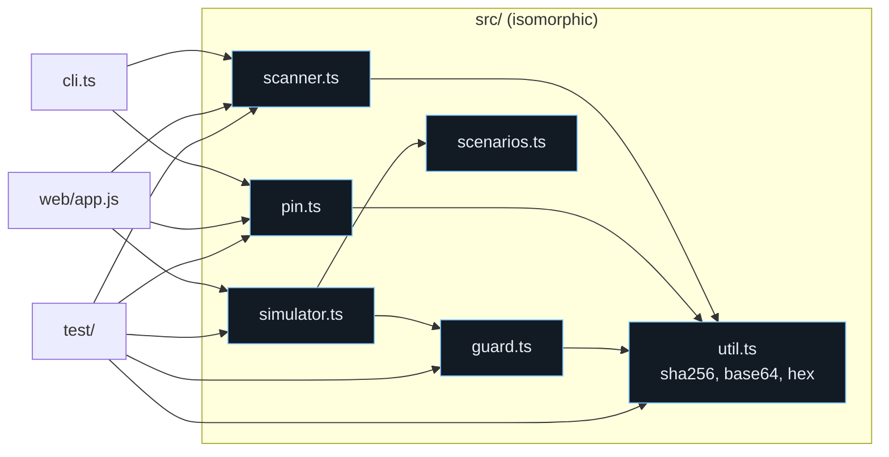

# Architecture

Tripline is a small, dependency free TypeScript engine with two front ends: a CLI and a browser app. The browser build is the same source, compiled by `tsc` into `web/engine`.

## Data model

* **Manifest**: `{ servers: [{ name, tools: [{ name, description, inputSchema }] }] }`.
* **Policy**: per tool flags `reads: 'private'`, `ingestsUntrusted`, `egress`, `destinationParam`, plus `allowedDestinations` and an optional `mode` of `enforce` or `monitor`.
* **Verdict**: `{ decision: allow | deny | ask, rules[], labels }`.

## Guard algorithm

1. `observe(tool, output)` runs after every call. Outputs of tools labelled private or untrusted are split into fragments (whole output, lines of 10 or more characters, and tokens that look like secrets) and stored.
2. `check(tool, args)` runs before every call. A call is judged if its tool is flagged `egress` **or** any argument carries an external URL. All string values in the arguments are searched for each stored fragment, for its re-encodings (base64, base64url, double base64, base32, hex in either case, URL encoding, reversal, ROT47), for every Caesar shift and Atbash of it (short fragments only), and for a case, spacing and punctuation insensitive match across all arguments joined together. All patterns are loaded into one prefix indexed multi pattern table, built incrementally as private data is read, so a check is a single linear scan of the arguments (about 4 ms for a 30 KB argument after reading a 3,000 line file).
3. The destination is compared against the allow list by exact match, e-mail domain, or subdomain, and **every** recipient or host in the value must pass. Look alikes such as `student.test.evil.test`, `evil.test/a@student.test` and a list containing one bad address do not pass.
4. **Content detection (R4, R5).** `src/detect.ts` recognises secret shaped data by what it is, with no provenance: AWS access and secret keys, GitHub, Google, Slack and Stripe tokens, JWTs, PEM and OpenSSH private keys, payment card numbers (Luhn validated), US SSNs (impossible ranges rejected), IBANs (mod 97 validated), bearer tokens, connection strings with passwords, and credential assignments. It also decodes one level of base64, base64url, hex and percent encoding before matching. Findings are masked and never contain the full value. A conclusive kind to a non allow-listed destination is denied (R4), with every kind found in the call listed together. A merely suspicious shape (credential assignment, long high entropy token) is held for approval (R5).
5. Rules apply in order R1, R3, R4, then R2 or R5 when nothing else fired. In `monitor` mode a would be block is reported but allowed.

## Scanner rules

| Id | Severity | Detects |
|---|---|---|
| TP001 | critical | Instructions aimed at the model inside metadata |
| TP002 | critical | Invisible or bidirectional Unicode |
| TP003 | high with hidden instruction wording, otherwise medium | References to sensitive files or keys |
| TP004 | high | Metadata steering other tools |
| TP005 | medium | Embedded external endpoints |
| TP006 | medium | Tool name shadowing across servers |
| TP007 | medium | Long encoded blobs |
| TP008 | high or low | Free form parameters able to carry stolen data |
| TP009 | medium | Imperatives addressed to the model (review only, common in honest docs) |

## X-ray and Arena

`src/explain.ts` locates, by position, where in a message private or secret shaped data hides: it searches for every re-encoding of each private fragment (exact, and with case or spacing changes mapped back onto the original text) and merges the content detector's findings. `src/arena.ts` wraps a `Guard`, a synthetic secret and an independent attacker's decoder (plain, base64, hex, base32, URL encoding, double encodings, reversal, every Caesar shift, Atbash, ROT47 and code words). The decoder is deliberately separate from the guard, so a bypass is reported as "recoverable and not stopped", and it cannot recognise an encoding nobody thought of, which is what the arena invites visitors to find. `web/arena.js` is the interface; it runs the same compiled engine as the tests.

## Build and test

`npm run build` runs `tsc -p tsconfig.web.json`. Tests use Node's built in runner on TypeScript sources directly. CI runs typecheck, build and tests, then deploys `web/` to GitHub Pages from the main branch.

## MCP proxy

`src/proxy.ts` sits on the stdio pipe between a client and a server and fails closed. It rewrites `tools/list` results to drop poisoned or drifted tools, answers blocked `tools/call` requests itself with `isError: true`, and observes results (text, resources, structured content) for provenance tracking. Requests it blocks are never written to the server. Calls before the first `tools/list`, batches containing `tools/call`, `tools/call` notifications and non JSON lines are dropped. An optional lockfile pins tools on first use. Rule R2 consults an optional `approve` callback (on the command line, `--approve-cmd`, where exit code 0 approves and everything else denies) and otherwise denies.

## Audit log, config wrapper and real run data

`src/audit.ts` is the pure chain logic: each entry stores the SHA-256 of its canonical JSON plus the previous entry's hash (the first points at `GENESIS`), arguments appear only as digests, and `verifyChain` reports the first entry that fails and why (edited, deleted, inserted, swapped, or the end no longer matching a stored anchor). `src/auditlog.ts` appends entries from the proxy (`--audit-log`). The same `audit.ts` runs in the browser for the Recorder section. A chain alone cannot prove the end was not cut off; that needs an anchor kept elsewhere.

`src/wrap.ts` rewrites an MCP client config so each stdio server starts through `tripline proxy`, with a per server lockfile and audit log, a backup file, idempotence, and an exact `unwrap`. Remote servers are reported and left alone.

`scripts/live-agent.ts` records full transcripts of live runs. `scripts/export-live.ts` removes local paths with `src/scrub.ts`, refuses to write anything that still looks like a path or API key, and produces `web/data/real-runs.json`, which `web/real.js` replays.
