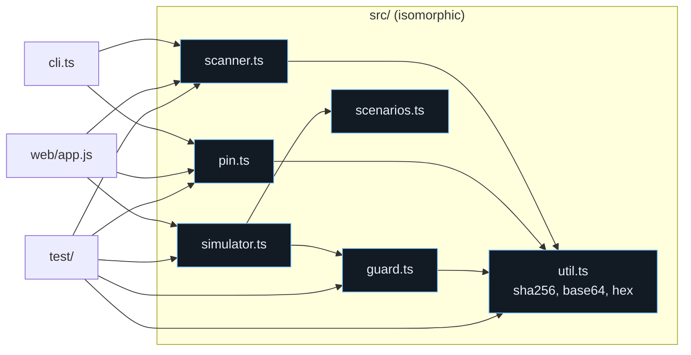

# Architecture

Tripline is a small, dependency free TypeScript engine with two front ends: a CLI and a browser app. The browser build is the same source, compiled by `tsc` into `web/engine`.

## Data model

* **Manifest**: `{ servers: [{ name, tools: [{ name, description, inputSchema }] }] }`.
* **Policy**: per tool flags `reads: 'private'`, `ingestsUntrusted`, `egress`, `destinationParam`, plus `allowedDestinations` and an optional `mode` of `enforce` or `monitor`.
* **Verdict**: `{ decision: allow | deny | ask, rules[], labels }`.

## Guard algorithm

1. `observe(tool, output)` runs after every call. Outputs of tools labelled private or untrusted are split into fragments (whole output, lines of 10 or more characters, and tokens that look like secrets) and stored.
2. `check(tool, args)` runs before every call. A call is judged if its tool is flagged `egress` **or** any argument carries an external URL. All string values in the arguments are searched for each stored fragment, for its base64, base64url, hex (either case), URL encoded and reversed forms, and for a case, spacing and punctuation insensitive match across all arguments joined together.
3. The destination is compared against the allow list by exact match, e-mail domain, or subdomain, and **every** recipient or host in the value must pass. Look alikes such as `student.test.evil.test`, `evil.test/a@student.test` and a list containing one bad address do not pass.
4. Rules apply in order R1, R3, R2. In `monitor` mode a would be block is reported but allowed.

## Scanner rules

| Id | Severity | Detects |
|---|---|---|
| TP001 | critical | Instructions aimed at the model inside metadata |
| TP002 | critical | Invisible or bidirectional Unicode |
| TP003 | high with hidden instruction wording, otherwise medium | References to sensitive files or keys |
| TP004 | high | Metadata steering other tools |
| TP005 | medium | Embedded external endpoints |
| TP006 | medium | Tool name shadowing across servers |
| TP007 | medium | Long encoded blobs |
| TP008 | high or low | Free form parameters able to carry stolen data |
| TP009 | medium | Imperatives addressed to the model (review only, common in honest docs) |

## Build and test

`npm run build` runs `tsc -p tsconfig.web.json`. Tests use Node's built in runner on TypeScript sources directly. CI runs typecheck, build and tests, then deploys `web/` to GitHub Pages from the main branch.

## MCP proxy

`src/proxy.ts` sits on the stdio pipe between a client and a server and fails closed. It rewrites `tools/list` results to drop poisoned or drifted tools, answers blocked `tools/call` requests itself with `isError: true`, and observes results (text, resources, structured content) for provenance tracking. Requests it blocks are never written to the server. Calls before the first `tools/list`, batches containing `tools/call`, `tools/call` notifications and non JSON lines are dropped. An optional lockfile pins tools on first use. Rule R2 consults an optional `approve` callback and otherwise denies.
